# 🛡️ Spate

**Global Solution 2026.2 — Android Kotlin Developer (Desafio CitizenTech)**
FIAP · 3º ano de Sistemas de Informação (3SIS) · Prof. Ewerton Luiz de Lima Carreira

## Integrantes

| Nome completo | RM |
|---|---|
| Yasmin Vaz | RM556763 |
| João Vinicius Hotz | RM556402 |

---

## O problema

Enchentes, deslizamentos, incêndios e ondas de calor atingem principalmente moradores de áreas de risco. Muitas vezes o aviso chega tarde, de forma genérica ou não chega, e a comunidade não sabe o que está acontecendo no próprio bairro nem como se proteger.

## Público beneficiado

- Moradores de áreas de risco (encostas, margens de córregos, regiões com vegetação seca).
- Agentes comunitários e lideranças de bairro, que registram e acompanham ocorrências.

## Proposta

**Spate** é um aplicativo Android para registrar e acompanhar alertas de risco por bairro. O usuário informa o tipo de risco (enchente, deslizamento, incêndio ou onda de calor), o local, uma descrição e o nível de risco, e acompanha a situação de cada alerta (ativo ou resolvido) em uma lista organizada e filtrável. Assim a informação fica direcionada ao bairro afetado e pode ser consultada rapidamente.

> Protótipo acadêmico. Os dados são cadastrados no próprio aparelho (ou carregados como exemplo). Não há integração com órgãos oficiais, backend ou dados em tempo real.

## ODS relacionados

| ODS | Conexão com o Spate |
|---|---|
| **ODS 11 — Cidades e comunidades sustentáveis** | Reduz o impacto de desastres sobre moradores (meta 11.5) e apoia comunidades mais seguras e resilientes. |
| **ODS 13 — Ação contra a mudança global do clima** | Eventos extremos (chuvas intensas, ondas de calor, queimadas) se intensificam com o clima; o app fortalece a capacidade de resposta e a conscientização local (meta 13.1). |
| **ODS 3 — Saúde e bem-estar** | Alertas de onda de calor e incêndio ajudam a prevenir riscos à saúde e à vida da população. |

## Funcionalidades

- Tela inicial com identidade visual, resumo (alertas ativos e críticos) e atalhos.
- Listagem de alertas com **filtro por tipo de risco**.
- **Cadastro** de alerta (tipo, bairro, descrição, nível de risco).
- **Validação** de campos obrigatórios (bairro e descrição).
- **Detalhes** do alerta.
- Ações sobre os registros: **editar**, **excluir** (com confirmação), **marcar como resolvido** e **favoritar**.
- Mensagens (Snackbar) para as ações realizadas e tela de estado vazio quando não há dados.
- **Persistência local com Room**: os alertas continuam salvos ao fechar e abrir o app.

## Tecnologias utilizadas

- Kotlin
- Jetpack Compose + Material 3
- Navigation Compose
- ViewModel + StateFlow (arquitetura MVVM com Repository)
- Room (com KSP)
- Android Studio · Gradle (Kotlin DSL)

## Estrutura do projeto

```
app/src/main/java/br/com/fiap/spate
├── model        # enums TipoAlerta e NivelRisco
├── data         # Alerta (entity), AlertaDao, SpateDatabase, AlertaRepository
├── viewmodel    # AlertaViewModel e FormState
├── navigation   # Rotas e SpateNavHost
├── ui
│   ├── components   # AlertaCard, NivelBadge, EstadoVazio, formatadores
│   ├── screens      # HomeScreen, ListaScreen, FormScreen, DetalheScreen
│   └── theme        # cores, tema e tipografia
└── MainActivity.kt
```

## Como executar

1. Instale o **Android Studio** (versão recente) com um Android SDK.
2. Abra a pasta do projeto em **File → Open**.
3. Aguarde o **Gradle Sync** terminar.
4. Crie ou escolha um emulador em **Device Manager** (ou conecte um aparelho com depuração USB).
5. Clique em **Run ▶️**.

Requisitos: Minimum SDK 24 (Android 7.0).

## Fluxo principal

1. Na **tela inicial**, toque em **Registrar novo alerta** (ou em **Ver alertas**).
2. Preencha o formulário e toque em **Registrar alerta**. Se faltar um campo obrigatório, o app mostra o erro e não salva.
3. Na **lista**, o alerta aparece com seu nível de risco. É possível filtrar por tipo, favoritar e marcar como resolvido.
4. Toque no alerta para ver os **detalhes**, **editar** ou **excluir**.
5. Feche e abra o app: os alertas continuam lá (Room).

## Capturas de tela

> Substituir pelas capturas reais do app em execução (pasta `docs/prints/`).

| Tela inicial | Lista de alertas | Cadastro |
|---|---|---|
| 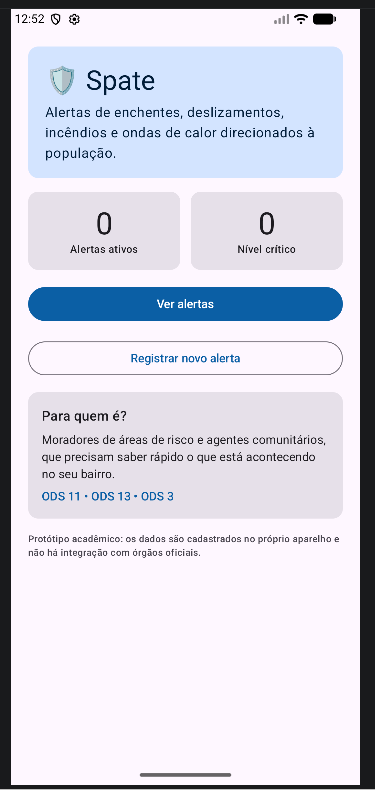 | 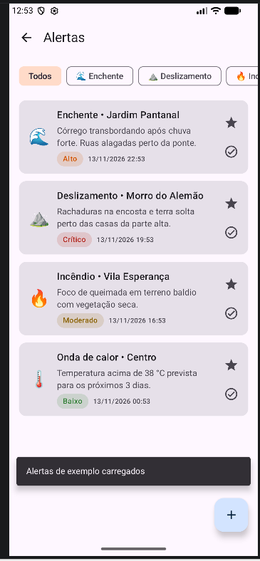 | 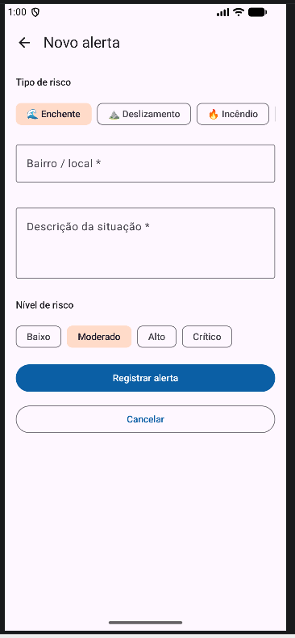 |

| Validação | Detalhes | Edição |
|---|---|---|
| 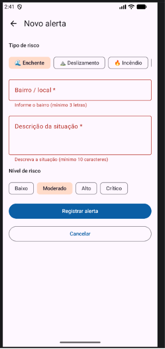 | 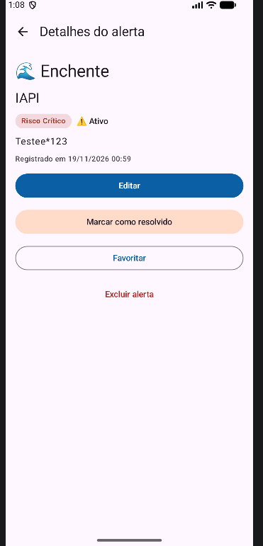 | 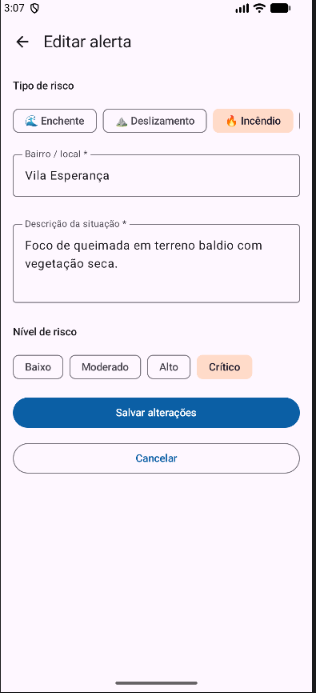 |

### Evidências de persistência

| 1. Registro criado | 2. Ação adicional (marcar como resolvido) | 3. Após fechar e reabrir o app |
|---|---|---|
| 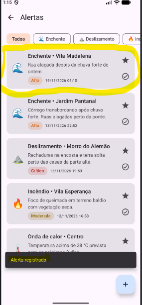 | 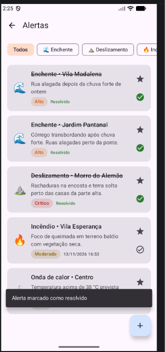 | 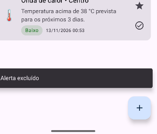 |

### Outras telas e estados

| Exclusão com confirmação | Alerta excluído | Lista sem registros |
|---|---|---|
| 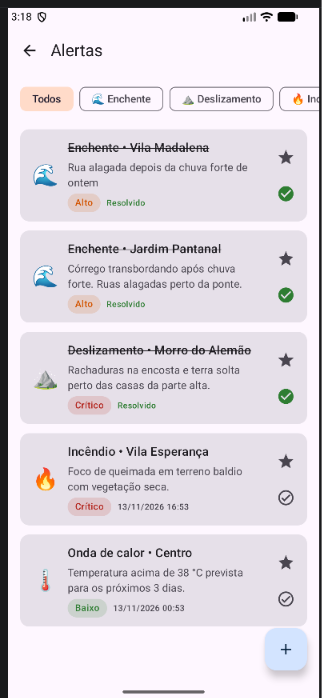 | 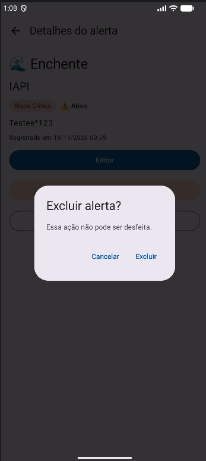 | 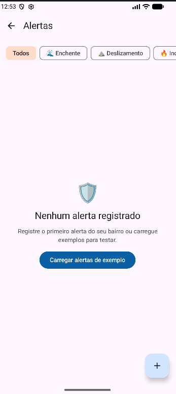 |
